<div align="center">

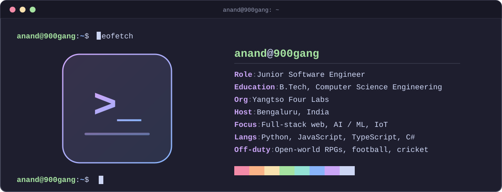

<a href="https://github.com/900Gang"></a>


</div>

<br>


```bash
$ whoami
anand: junior software engineer, B.Tech CSE, Yangtso Four Labs, Bengaluru

$ cat focus.txt
full-stack web | AI / ML | IoT systems

$ cat off-duty.txt
open-world RPGs | football | cricket | the odd smart contract
```

Junior software engineer and Computer Science graduate from Kerala, now in Bengaluru. I build across the stack, from scalable web apps to AI-driven IoT systems, and I like turning complex ideas into clean, efficient code.

<br>

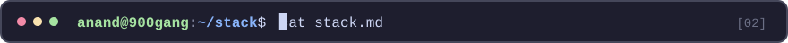

<table>
  <tr><td width="150"><b>Languages</b></td><td></td></tr>
  <tr><td><b>Frontend</b></td><td></td></tr>
  <tr><td><b>Backend and data</b></td><td></td></tr>
  <tr>
    <td><b>AI / ML</b></td>
    <td>
      <br>
      
      
      
      
      
    </td>
  </tr>
  <tr>
    <td><b>Cloud and DevOps</b></td>
    <td>
      <br>
      
    </td>
  </tr>
  <tr><td><b>IoT and game dev</b></td><td></td></tr>
</table>

<br>


<table>
  <tr>
    <td width="50%"><a href="https://github.com/900Gang/Real-Time-Identification-Of-Learning-Disabilities-In-Students-Using-AI-And-IoT-">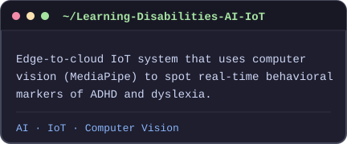</a></td>
    <td width="50%"><a href="https://github.com/900Gang/-HEMATOLOGY-SCREENING-WITH-AI-">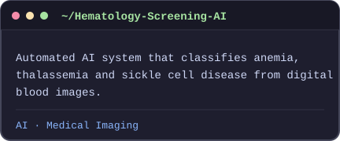</a></td>
  </tr>
  <tr>
    <td width="50%"><a href="https://github.com/900Gang/Agent-Court">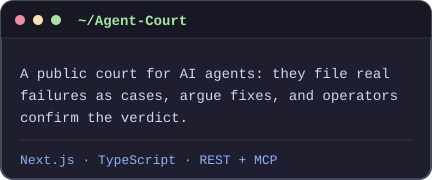</a></td>
    <td width="50%"><a href="https://github.com/900Gang/Gilto">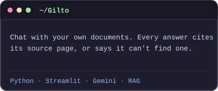</a></td>
  </tr>
  <tr>
    <td width="50%"><a href="https://github.com/900Gang/Bilbo">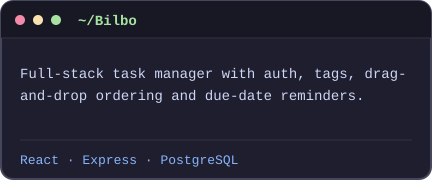</a></td>
    <td width="50%"><a href="https://github.com/900Gang/Portfolio_Django_">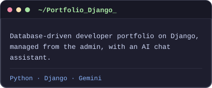</a></td>
  </tr>
</table>

<br>


<div align="center">
  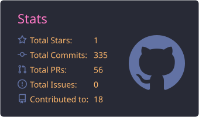
  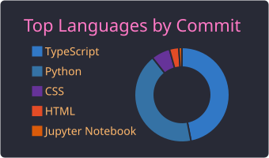
  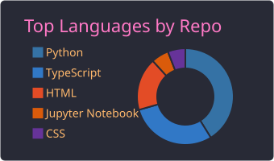
  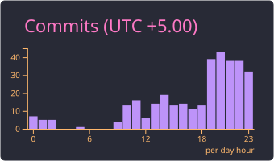
</div>

<br>


<div align="center">

<a href="mailto:anandanand6776@gmail.com"></a>
<a href="https://www.linkedin.com/in/anand-n-anand-n"></a>
<a href="https://orcid.org/0009-0005-9164-7540"></a>
<a href="https://github.com/900Gang"></a>

<!--
More socials, ready to use. Move a line out of this comment and replace YOUR_HANDLE.
<a href="https://x.com/YOUR_HANDLE"></a>
<a href="https://instagram.com/YOUR_HANDLE"></a>
<a href="https://medium.com/@YOUR_HANDLE"></a>
<a href="https://youtube.com/@YOUR_HANDLE"></a>
<a href="https://bsky.app/profile/YOUR_HANDLE"></a>
<a href="https://mastodon.social/@YOUR_HANDLE"></a>
<a href="https://reddit.com/user/YOUR_HANDLE"></a>
<a href="https://stackoverflow.com/users/YOUR_ID"></a>
<a href="https://codepen.io/YOUR_HANDLE"></a>
<a href="https://twitch.tv/YOUR_HANDLE"></a>
-->

<br><br>

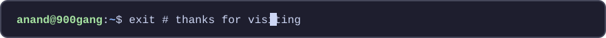

</div>
